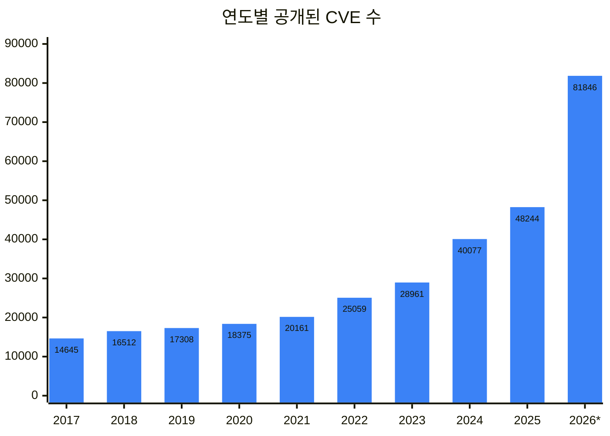
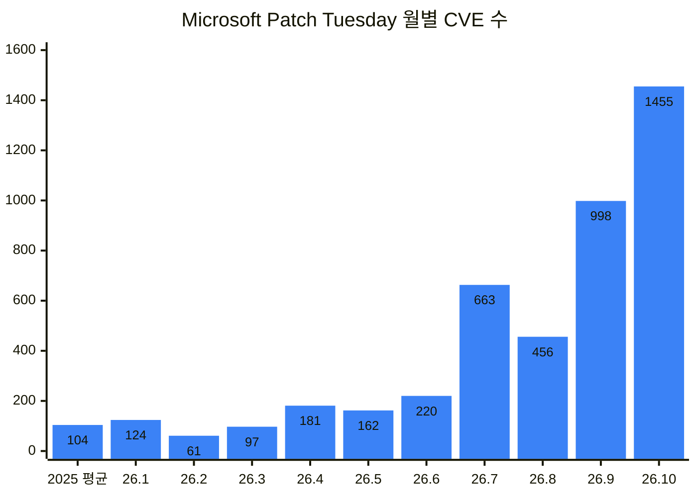

며칠 전 [AI scanner가 찾은 취약점을 개발자에게 전달하기](/posts/from-ai-found-bug-to-fix-ko/)에서는 AI가 찾은 버그가 maintainer에게 넘어가 고쳐지기까지를 정리했다. 하지만 고쳤다고 끝나는 건 아니다. 패치가 나와도 실제 서버와 기기에 깔리기까지는 또 시간이 걸리고, 그 사이에 공격자는 패치를 보고 exploit을 만든다.

사실 3월에 쓴 짧은 글 [AI로 가속화되는 공격과 방어의 갭](/posts/ai-accelerating-attack-defense-gap-ko/)에서도 비슷한 질문을 던졌다. 취약점이 공개되고 exploit이 나오기까지의 시간이 점점 짧아지는데, 패치가 그 속도를 따라갈 수 있을까? 취약점을 다 없애기 어렵다면, 취약점이 있어도 피해가 번지는 범위(blast radius)를 줄이는 게 더 중요해지지 않을까? 그때는 거의 감으로 던진 질문이었다.

그 뒤 7개월 동안 AI가 찾은 버그와 exploit 소식은 더 많아졌고, 관련 데이터도 꽤 나왔다. 그래서 그 질문들을 숫자로 다시 확인해 봤다.

## 취약점이 쏟아지는 시대

요즘은 AI로 버그를 찾고 exploit까지 만들었다는 소식이 거의 매주 나온다. Apple이 8월에 macOS 화면 공유(Screen Sharing)의 인증 없는 원격 root 버그를 긴급 패치하자, Calif는 패치 전후 비교를 시작한 지 약 4시간 만에 exploit을 만들었다[^calif-screen-sharing].

CVE 수도 계속 늘고 있다.

_\* 2026년은 10월 17일까지. 출처: 2025년까지는 CVE.org 공식 집계[^cve-metrics], 2026년은 cve.icu (NVD·CVE 레코드 기준)[^cve-icu]_

2026년은 아직 두 달 넘게 남았는데 벌써 작년의 1.7배다. 다만 버그가 그만큼 늘었다는 뜻은 아니다. Linux kernel은 직접 CVE를 발급하는 CNA가 된 뒤 보안 문제일 수 있는 수정에 폭넓게 CVE를 붙이는데[^kernel-cve-docs], Google Threat Intelligence Group(GTIG)에 따르면 올해 1~8월 'Linux Kernel' CVE 5,000개 정도 중 zero-day로 악용된 건 하나도 없었다[^gtig-ai-era].

그래도 기록이 늘면 고쳐야 할 목록도 는다. Microsoft가 발급한 CVE는 올해 7월부터 몇 배로 뛰었다.

_첫 막대는 2025년 월평균. Security Update Guide에서 Microsoft가 발급한 CVE만 셌다(2026년 10월 17일 기준)[^msrc-update-guide]._

Microsoft에 있는 우리 팀이 만든 AI 취약점 탐지 시스템 MDASH로 찾아 고친 Windows CVE도 5~9월에만 140개다[^ms-frontier-ai-lessons]. 더 많이 찾을수록 고객이 받아야 할 패치도 는다.

exploit도 늘었다. GTIG가 집계한 올해 1~8월 실제 악용 취약점은 141개로 이미 작년 전체(127개)보다 많다. GTIG는 증가가 주로 이미 고친 버그(n-day)를 빠르게 무기화한 데서 나왔고, LLM으로 패치 비교가 쉬워진 게 이유일 수 있다고 본다. 악용이 관측된 건 올해 공개된 취약점의 0.23% 정도지만[^gtig-ai-era], 그 소수는 빠르게 무기가 되고 그 재료는 패치다.

## 공격은 빨라졌다

공격하는 쪽은 공개된 정보로 exploit을 만들어 스캔하면 되지만, 방어하는 쪽은 영향 분석부터 패치 개발, 테스트, 배포를 거쳐 사용자가 업데이트할 때까지 기다려야 한다. 그래서 패치가 나온 뒤 악용되기까지의 시간이 짧아질수록 방어하는 쪽이 불리해진다.

이 시간은 AI 이전에도 빠르게 줄고 있었다. Mandiant 집계로 2018~19년에는 평균 63일이었는데, 2023년에는 5일이 됐다[^mandiant-tte-2023].

SharePoint의 ToolShell을 보면, 작년 7월 8일에 패치가 나오고 열흘 뒤인 7월 18일부터 대규모 공격이 시작돼 400개가 넘는 시스템이 뚫렸다[^eye-sharepoint].

AI는 이 시간을 더 줄이고 있다. Microsoft Edge 팀은 10월 7일, Chromium 수정을 보고 exploit을 만드는 공격을 patch-gap abuse라고 부르며 몇 주 걸리던 이 분석을 AI가 몇 시간으로 줄일 수 있다고 했다. 그래서 Edge는 CVE 공개 전에도 중요한 보안 업데이트를 먼저 낼 수 있게 했다[^edge-patch-gap].

몇 주라는 건 내 경험과도 맞는다. 2022년 말 V8을 처음 다뤄 보는 팀원들과 5주 동안 한 기기의 Chromium 기반 브라우저에서 이미 고쳐진 1-day를 찾았는데, PoC를 ARM 기기에 맞게 옮기고 crash를 exploit으로 키우는 데 시간이 대부분 들어서 exploit까지 만든 건 2개뿐이었다. 지금 우리 팀의 경험을 보면 그 시간이 훨씬 단축됐다.

AI로 얼마나 빨라졌는지는 Anthropic이 6월에 공개한 실험에서 숫자로 볼 수 있다. 패치가 나온 날 공격자가 구할 수 있는 자료만 주고 exploit을 만들게 했더니[^anthropic-n-days], Claude Mythos Preview는 Firefox JavaScript 엔진 보안 패치 18개 중 8개로 코드 실행 exploit을 만들었고, 첫 exploit은 한 시간이 안 돼 나왔다. 소스 코드 없는 Windows kernel 패치로도 SYSTEM 권한 exploit chain을 8개 만들었는데, Autopatch 일정대로라면 어떤 기기에도 패치가 가기 전이었다. Anthropic은 실제 공격까지는 일이 더 필요하다면서도, 이제 'N-day'보다 'N-hour'가 현실에 가깝다고 썼다.

## 패치는 여전히 늦게 도착한다

patch gap은 upstream을 가져다 쓰는 쪽으로 내려갈수록 길어진다. OtterSec은 이런 쪽이 업데이트를 따라가지 못하거나, 수정을 잘못 옮기거나, 아예 잊기도 한다고 쓴다. 4월에는 Galaxy S25의 기본 브라우저인 Samsung Internet이 6개월 지난 V8을 써서, 이미 공개된 버그로 renderer RCE를 만들 수 있었다[^ottersec-samsung].

모바일은 단계가 더 많다. 3월 글에서는 스마트폰 패치가 통신사를 거쳐 사용자에게 닿기까지 6개월 넘게 걸릴 수 있다고 썼는데, 통신사 전에 upstream 수정이 Android에 들어가는 데만 6개월이 걸린 사례도 있다. ARM이 2022년 10월에 고친 Mali GPU 드라이버 버그(CVE-2022-38181)는 2023년 4월에야 Android 보안 업데이트에 들어갔고, 그사이 2022년 11월부터 실제 공격에 쓰였다[^bleeping-android-patch-gap].

패치가 도착해도 누군가 깔아야 하는데, 이 단계는 오히려 느려졌다. Verizon 2026 DBIR에 따르면 조직이 실제로 악용 중인 취약점(CISA KEV)을 완전히 고친 비율은 2024년 38%에서 2025년 26%로 떨어졌고, 걸린 시간의 중앙값은 32일에서 43일로 늘었다[^verizon-dbir-2026].

숫자마다 한계는 있지만 방향은 분명하다. 실제로 악용되는 소수의 취약점은 패치가 깔리는 속도보다 빨리 무기가 된다.

## 내가 영향을 받는지부터 알아야 한다

방어의 첫 단계는 영향 분석이다. 새 취약점이 나오면 그 컴포넌트가 우리 제품 어디에 있는지부터 알아야 하는데, Log4Shell 때 많은 조직이 바로 답하지 못했다. 이걸 미리 적어 두는 게 SBOM(Software Bill of Materials)이다.

그런데 실제 SBOM은 생각보다 비어 있다. SBOM 78,612개를 분석한 연구에서 52.9%는 컴포넌트 사이의 의존 관계를 하나도 적지 않았다. 연구진의 우선순위 시스템은 이렇게 빈 관계를 보고 "경로가 없으니 도달할 수 없다"고 판단하는 바람에 실제로 악용된 취약점 20건 중 7건을 놓쳤고, Log4Shell도 그중 하나였다[^arxiv-sbom-edges].

AI 시대에 더 신경 쓰이는 건 CVE 없이 나가는 패치다. SBOM으로 영향을 확인하려면 결국 CVE 같은 식별자와 맞춰 봐야 하는데, GTIG에 따르면 큰 클라우드·SaaS 회사들은 AI가 찾은 취약점을 CVE 없이 production에서 바로 고친다[^gtig-ai-era]. SaaS는 회사가 고치면 사용자가 할 일이 없으니 괜찮다.

문제는 직접 설치해서 쓰는 소프트웨어다. STAR Labs의 한 연구원은 AI 버그 헌팅 harness로 Cisco Smart Software Manager의 인증 후 RCE를 1시간 안에 찾았는데, 제보하기도 전에 다음 날 업데이트에서 조용히 고쳐졌다[^starlabs-dirty-cert]. 같은 버전에서 고쳐진 command injection의 CVE와 advisory는 두 달 가까이 지난 10월 7일에야 나왔다[^cisco-ssm-adv]. 그사이에는 SBOM과 CVE를 맞춰 봐도 이 패치가 보이지 않는다. 그래서 필요한 패치를 골라 까는 것만큼, 늘 최신으로 유지하는 비용을 낮추는 게 중요하다.

## 패치 사이클을 어떻게 짧게 할까

그 비용은 어떻게 낮출까? [지난 글](/posts/from-ai-found-bug-to-fix-ko/)에서는 충분히 검증하고 조심스럽게 낼지, AI로 빨리 내고 문제가 생기면 다시 고칠지 물었는데, 둘 중 하나를 고르는 문제는 아니었다. 빠르게 내보내되 단계를 나누고 되돌릴 수 있게 만드는 쪽으로 가고 있다.

패치를 보안 문제이기 전에 배포 문제로 보는 것이다. 보안 개념을 운영의 언어로 옮기면 이렇다.

- 취약점은 잠재적인 장애다.
- 패치는 안전하게 배포해야 하는 변경 단위다.
- 검증 실패는 롤백 조건이다.

실제로 쓰이는 방법들을 이 틀에 맞춰 보면 이렇다.

**보안 수정을 작게, 기능과 따로 내보낸다.** Chrome은 2023년부터 매주 릴리스해서 보안 수정을 평균 3.5일 더 빨리 내보낸다[^chrome-weekly-updates]. Windows Server 2025의 hotpatch는 보안 수정만 담아 재부팅 없이 적용하고, 계획된 재부팅을 매달에서 1년에 4번 정도로 줄였다[^ms-hotpatch].

**단계적으로 배포하고, 문제가 보이면 멈추고, 문제만 되돌린다.** 반대 사례가 2024년 7월 CrowdStrike 사고다. 콘텐츠 업데이트 하나로 Windows 850만 대 정도가 멈췄다[^ms-crowdstrike]. CrowdStrike는 이 업데이트를 단계 없이 한꺼번에 내보냈고, 이후 canary와 ring으로 나눠 배포하고 되돌릴 수 있게 바꿨다[^crowdstrike-rca]. Windows Autopatch도 ring마다 안정성 신호가 나빠지면 배포를 멈추고, Known Issue Rollback으로 문제가 된 변경만 되돌려 보안 수정은 남긴다[^windows-vuln-mgmt].

**승인 단계를 늘리기보다 검증을 자동화한다.** DORA 연구에서는 외부 변경 승인 위원회(CAB) 같은 절차가 배포 성능을 떨어뜨렸고, 실패율을 낮춘다는 근거는 찾지 못했다. 대신 동료 리뷰와 자동화된 테스트로 나쁜 변경을 일찍 잡으라고 권한다[^dora-change-approval].

**원인과 변형까지 고친다.** 첫 패치가 틀리면 빠른 패치가 두 번의 패치가 된다. ToolShell도 7월 8일 패치를 우회하는 변형이 나와 긴급 패치를 다시 내야 했다[^ms-sharepoint-toolshell]. Project Zero는 2022년 상반기에 관측된 zero-day의 절반 정도가 이미 패치된 버그의 변형이었다고 했다[^p0-mind-the-gap].

## 무엇부터 고칠까

순서를 정하는 기준도 CVSS 점수에서 실제로 악용될 위험으로 옮겨 가고 있다. Android Authority에 따르면 Android는 2025년 7월부터 월간 보안 게시판에 실제로 악용 중이거나 알려진 공격 체인에 들어간 것 같은 고위험 취약점만 넣고, 대부분의 수정은 분기마다 묶어서 낸다[^androidauthority-risk-based].

기준에 따라 얼마나 달라지는지는 Zero Day Clock이 매달 계산한다. CVSS 9 이상을 모두 고치려면 한 달에 1,553개를 고쳐야 하는데, 9월에 새로 공격받은 취약점 131개 중 이 목록에 미리 들어 있던 건 절반뿐이었다. 반면 KEV 목록에 있거나 EPSS(30일 내 악용 확률 추정치)가 3% 이상인 것만 고치면 한 달 629개로 줄어드는데도, 79%가 미리 들어 있었다[^zdc-home]. 허니팟과 IDS 센서로 본 작은 표본이지만 차이는 분명하다.

그래도 KEV와 EPSS는 내 환경을 모른다. 어떤 취약점이 이미 악용됐는지, 곧 악용될 것 같은지만 알려 주고, 그 값은 누구에게나 같다. 실제 위험은 여기에 내 환경에서 인터넷에 노출돼 있는지, 공격자가 닿을 수 있는지, 터지면 어디까지 번지는지를 더해야 정해진다. CVSS도 기본 점수는 취약점 자체의 심각도(severity)만 나타내고, 환경에 따른 영향은 쓰는 조직이 매기도록 나눠 두었다[^cvss-31-spec]. 다만 우선순위는 무엇을 먼저 할지의 문제지, 나머지를 안 해도 된다는 뜻은 아니다.

## 패치가 오기 전까지 버틸 수 있을까

순서를 잘 정하고 빨리 고쳐도 빈틈은 남는다. VulnCheck에 따르면 2025년에 처음 악용이 확인된 취약점 884개 중 29% 정도는 CVE 공개 당일이나 그 전에 악용됐다[^vulncheck-2026]. 이 중 패치보다 먼저 악용된 건 패치 속도로는 막을 수 없다.

그래서 앞서가는 회사들은 버그를 하나씩 고치는 대신 같은 종류의 버그가 아예 생기지 않게 만든다. Android는 새 코드를 Rust 같은 메모리 안전 언어로 쓰면서, 메모리 안전 취약점 비율이 2019년 76%[^google-memory-safety]에서 2025년 20% 아래로 떨어졌다[^google-rust-android]. 취약점은 대부분 새로 쓰거나 최근에 고친 코드에 있어서, 새 코드부터 안전하게 쓰면 전체가 줄어든다[^google-memory-safety]. 웹에서도 Google은 주력 프레임워크로 만든 앱에서 XSS와 SQL injection을 거의 없앴다[^google-secure-by-design].

속도도 흥미롭다. Android의 Rust 변경은 C++ 변경보다 rollback이 4배 적었다(중간 이상 크기 변경 기준)[^google-rust-android]. 보안을 챙기는 게 늘 속도를 늦추는 건 아니다.

이미 있는 코드의 메모리 버그는 OS와 칩 차원에서 막기도 한다. Apple의 공격 연구팀은 그동안 iPhone을 노린 실제 spyware exploit chain들을 메모리 보호 기능 MIE가 켜진 기기에서 다시 동작하게 만들어 보려 했지만, 하나도 성공하지 못했다고 한다[^apple-mie]. 완벽하지는 않겠지만, 이런 장치는 공격을 막는다기보다 비용을 크게 올린다.

그래도 버그를 다 없앨 수는 없으니, 뚫렸을 때 피해가 번지는 범위(blast radius)를 줄여야 한다. 서비스 A의 취약점 하나로 DB 전체를 가져갈 수 있다면 blast radius가 크지만, 서비스 A의 데이터에만 닿게 설계했다면 피해는 거기서 멈춘다. 최소 권한, 서비스 격리, identity 분리, 실행 중 탐지 같은 방법이 여기에 쓰인다.

이렇게 나눠 두지 않으면 버그 하나가 곧 전체 침해로 이어진다. 특히 identity는 한번 탈취되면 여러 경계를 한꺼번에 넘는다. CISA에 따르면 Volt Typhoon은 패치 안 된 Fortinet 장비에 잘못 저장된 도메인 관리자 계정을 손에 넣었고, 한 수도 시설에서는 관리자 계정으로 domain controller와 vCenter를 거쳐 정수장과 변전소 장비 접속 정보에도 접근했을 수 있다[^cisa-aa24-038a].

그렇다고 blast radius를 줄이는 게 패치를 대신하지는 못한다. M-Trends 2026에서 exploit은 6년 연속 가장 흔한 침투 경로였다(32%). 스파이 그룹은 EDR이 없어 들여다보기 어려운 VPN과 라우터를 노리고, BRICKSTORM backdoor는 이런 장비에 400일 가까이 숨어 있어 90일 보관 로그로는 흔적을 찾을 수 없었다[^m-trends-2026]. CISA의 Volt Typhoon 권고문도 첫 대응으로 인터넷에 노출된 시스템 패치를 꼽는다[^cisa-aa24-038a].

정리하면 세 가지를 같이 해야 할 것 같다. 같은 종류의 버그는 설계로 없애고, 남는 버그는 가두고, 가둘 수 없는 인터넷 노출 장비는 가장 빨리 패치하면서 identity를 늘 지켜본다.

## 보안팀이 관문이 되면

패치가 이렇게 쏟아지면 누가 다 확인할까? 보안팀이 모든 패치와 변경을 검토하는 관문이 되면 bottleneck이 되기 쉽다. [에이전트에게 일을 맡기면 판단은 누가 할까?](/posts/agent-delegation-and-code-review-ko/)에서 쓴 사람의 컨펌 문제와 같다.

그래서 나는 보안 내재화를 개발자에게 보안을 더 가르치는 일이 아니라, 개발자가 보안을 의식하지 않아도 더 안전한 선택을 반복하게 만드는 일로 본다. 앞의 Google 사례가 그렇고, Google의 Secure by Design 글도 보안을 개발자 개인이 아니라 개발 환경이 책임져야 한다고 쓴다[^google-secure-by-design].

그 환경을 누가 만드는지에 대해서는 Dan McKinley의 Egoless Engineering 발표가 기억에 남는다[^egoless-engineering].

- 1,000명이 넘는 B2B 회사에서는 보안 일을 전부 보안팀이 맡게 했는데 버티지 못했다. 개발과 보안 사이에 벽을 세우면 오히려 보안 일이 더 생긴다.
- 한 스타트업에서는 디자이너에게 배포 권한을 줬고, 엔지니어들은 남는 시간에 모니터링과 테스트를 만들어 그 배포를 안전하게 했다. 아무 일도 일어나지 않았다.

그 회사는 domain expert는 두되 domain owner는 두지 않으려 했고, 그러려면 권한(permission)과 여유(slack)가 필요하다고 한다. 신뢰만이 아니라 여유 시간에 만든 가드레일이 안전을 만들었다. 다만 보안팀이 관문이 되면 패치가 느려진다는 걸 직접 보인 연구는 찾지 못했다.

AI를 쓰는 보안팀도 owner가 아니라 expert가 되어야 한다. 모든 패치를 직접 검토하는 대신, 무엇을 자동화할지 정하고 안전한 기본값과 테스트, 단계적 배포와 rollback을 깔아 두는 것이다.

## 에이전트가 쓰는 소프트웨어는 누가 패치할까

에이전트 시스템도 같은 patch gap을 안고 있다. sandbox 안의 브라우저, 이미지와 음성 코덱, 문서 파서, 수많은 라이브러리가 각자의 patch gap을 가진다.

Hacktron이 9월에 공개한 OpenAI 사례가 이 gap이 어디까지 이어지는지 보여 준다[^hacktron-openai]. 이미지 라이브러리 libheif의 버그는 upstream에서 작년에 코드가 바뀌면서 고쳐졌지만, 보안 수정 표시도 CVE도 없었고 Debian 12와 13에는 제때 backport되지 않았다. Hacktron은 표시가 없었던 게 이유일 수 있다고 본다. OpenAI 커뮤니티 포럼이 쓰는 Discourse의 Docker 이미지는 Debian 12 기반이라 이 libheif를 그대로 썼고, Hacktron은 Claude로 만든 exploit으로 HEIC 이미지 업로드만으로 포럼 서버에서 코드를 실행했다. 여기에 OpenAI SSO 설정 문제가 겹쳐 포럼에 로그인한 사용자의 ChatGPT와 Codex 계정을 넘겨받을 수 있었고, 실제로 GitHub이 연결된 OpenAI 직원의 Codex로 내부 monorepo에 PR까지 올렸다. 버그를 찾고 여기까지 사흘이 안 걸렸다.

뚫린 건 에이전트의 sandbox가 아니라 포럼 서버였지만, upstream에서 조용히 고쳐진 버그 하나가 identity와 에이전트의 GitHub 연결을 타고 회사 내부 저장소까지 이어졌다. 에이전트는 들어올 문(sandbox 안의 의존 소프트웨어)도, 들어온 뒤 갈 곳(connector와 권한)도 늘린다.

모델 회사와 에이전트 시스템은 아직 초기라, 기능을 붙이는 속도에 비해 패치 관리는 부족할 수 있다. sandbox 안에 무엇이 있는지 알고, 늘 최신으로 유지하고, 뚫려도 번지지 않게 가두는 걸 어떻게 같이 할 수 있을까?

## 패치를 깔 수 없거나, 아예 오지 않는다면

지금까지 본 방법들은 패치가 늦게라도 오고, 오면 깔 수 있다는 걸 전제로 한다. 앞의 Anthropic 글은 패치를 무기로 만드는 비용이 0에 가까워질수록 원래 패치가 어려운 산업 제어 시스템, 의료기기, IoT 기기가 더 위험해진다고 끝맺는다[^anthropic-n-days].

공장과 병원은 패치가 와도 깔기 어렵다. 직접 겪어 보니 공장은 라인이 잠깐만 멈춰도 몇백억 원이 날아갈 수 있어서, 장비 소프트웨어는 오래 검증하고 그동안 옛 버전으로 돌아간다. 2018년 TSMC에서는 새 장비 설치 때 바이러스 검사를 빠뜨려 WannaCry 변종이 패치 안 된 Windows 7 장비로 퍼졌고, 여러 공장이 멈춰 1억 7,000만 달러 정도의 손실이 추산됐다[^bankinfosec-tsmc].

병원에서는 업데이트가 환자 안전 문제가 된다. 2017년 Abbott는 근처에서 무선으로 pacemaker 설정을 바꿀 수 있는 취약점의 firmware 업데이트를 내면서, 업데이트 중 기기가 이전 firmware로 돌아가거나 멈출 작은 위험이 있으니 의사가 환자와 상의해 정하라고 했다[^abbott-pacemaker].

병원 전체로 봐도 비슷하다. Claroty가 의료기관 351곳의 의료기기 225만 대 이상을 분석해 보니 99%의 기관에 이미 악용 중인 취약점(KEV)이 있는 기기가 있었고, 제조사 제약이나 진료 중단 걱정 때문에 이런 기기는 쉽게 업데이트하지 못한다고 본다[^claroty-healthcare-2025].

이런 곳에서는 단계적으로 배포해도 업데이트 하나가 현장마다 무엇을 깨뜨릴지 미리 다 검증할 수 없다. EU Cyber Resilience Act도 2027년 12월부터 자동 보안 업데이트를 기본으로 켜 두라고 요구하면서, 자동 업데이트가 운영을 방해할 수 있는 산업 환경 같은 곳은 예외로 둔다[^eu-cra-regulation].

더 어려운 건 만든 회사가 사라지거나 지원이 끝나서 패치가 아예 오지 않는 경우다. runZero가 미국 기업 수백 곳의 자산 800만 개 정도를 조사해 보니, 공장이나 병원만이 아니라 기업 전체 자산의 5%가 연장 지원까지 끝난 OS를 쓰고 있었다[^runzero-undead]. 패치를 깔 수 없거나 아예 오지 않는 곳에서는, 결국 가두거나 바꾸는 것밖에 없는 걸까?

## 마치며

지난 글에서는 찾았다는 것만으로는 아무것도 고쳐지지 않는다고 썼다. 이번에 보니 고쳤다는 것만으로도 아직 아무도 지켜지지 않는다. 실제로 악용되는 취약점은 패치가 깔리기 전에 무기가 되고, 가둬 두는 것만으로는 패치를 대신할 수 없다. 결국 패치를 받는 일 자체를 싸고 안전하게 만들어야 하는데, 에이전트와 공장, 병원까지 생각하면 아직 갈 길이 멀다.

## 3줄요약

- AI로 패치를 보고 exploit을 만드는 시간이 몇 시간까지 줄 수 있게 됐는데, 패치가 upstream에서 사용자 기기까지 내려가는 데는 여전히 몇 주에서 몇 달이 걸린다.
- CVE 없이 고쳐지는 버그도 많아서, 골라 고치는 것만큼 늘 최신으로 유지하기 쉽게 만드는 게 중요하다. 보안 수정은 작게 따로, 자동으로 내보내고, 순서는 CVSS가 아니라 실제 위험으로 정한다.
- 패치만으로는 부족하다. 같은 종류의 버그를 없애고, 남은 건 가두고, 가둘 수 없는 노출면은 가장 빨리 패치하는 걸 같이 해야 한다.

## 참고 자료

* 참고 자료
{:footnotes}

[^calif-screen-sharing]: [Calif, No Country for Old Passwords (2026-08-10)](https://blog.calif.io/p/no-country-for-old-passwords)
[^cve-metrics]: [CVE.org, Metrics](https://www.cve.org/about/Metrics)
[^cve-icu]: [cve.icu](https://cve.icu/)
[^kernel-cve-docs]: [The Linux Kernel Documentation, CVEs](https://docs.kernel.org/process/cve.html)
[^gtig-ai-era]: [Google Threat Intelligence Group, Vulnerability Discovery and Exploitation Trends in the AI Era (2026-09-30)](https://cloud.google.com/blog/topics/threat-intelligence/vulnerability-discovery-and-exploitation-trends-in-the-ai-era)
[^msrc-update-guide]: [Microsoft, Security Update Guide](https://msrc.microsoft.com/update-guide)
[^ms-frontier-ai-lessons]: [Microsoft Security, 3 Lessons from Frontier AI Vulnerability Research (2026-10-07)](https://www.microsoft.com/en-us/security/blog/2026/10/07/3-lessons-from-frontier-ai-vulnerability-research/)
[^mandiant-tte-2023]: [Mandiant, How Low Can You Go? An Analysis of 2023 Time-to-Exploit Trends (2024-10-15)](https://cloud.google.com/blog/topics/threat-intelligence/time-to-exploit-trends-2023)
[^eye-sharepoint]: [Eye Security, SharePoint Under Siege (2025-07-19)](https://labs.eye.security/sharepoint-under-siege/)
[^edge-patch-gap]: [Microsoft Edge, AI and the Rise of Patch-Gap Abuse (2026-10-07)](https://microsoftedge.github.io/edgevr/posts/AI-And-Rise-Patch-Gap-Abuse/)
[^anthropic-n-days]: [Anthropic, Measuring LLMs' Impact on N-day Exploits (2026-06-08)](https://www.anthropic.com/research/n-days)
[^ottersec-samsung]: [OtterSec, Patch Gap to Mobile Renderer RCE: Pwning Samsung Internet's V8 on the Galaxy S25 (2026-04-01)](https://osec.io/blog/patch-gap-to-mobile-renderer-rce/)
[^bleeping-android-patch-gap]: [BleepingComputer, Google: Android Patch Gap Makes N-Days as Dangerous as Zero-Days (2023-07-30)](https://www.bleepingcomputer.com/news/security/google-android-patch-gap-makes-n-days-as-dangerous-as-zero-days/)
[^verizon-dbir-2026]: [Verizon, 2026 Data Breach Investigations Report](https://www.verizon.com/business/resources/T1ae/reports/2026-dbir-data-breach-investigations-report.pdf)
[^arxiv-sbom-edges]: [No Edges, No Verdict (arXiv, 2026-07)](https://arxiv.org/abs/2607.22140)
[^starlabs-dirty-cert]: [STAR Labs, Dirty Cert: Cisco Smart Software Manager's Silently Patched RCE (2026-09-24)](https://starlabs.sg/blog/2026/09-dirty-cert-cisco-smart-software-managers-silently-patched-rce/)
[^cisco-ssm-adv]: [Cisco, Cisco License (Smart Software Manager) On-Prem Vulnerabilities (2026-10-07)](https://sec.cloudapps.cisco.com/security/center/content/CiscoSecurityAdvisory/cisco-sa-ssm-access-nttb2dhE)
[^chrome-weekly-updates]: [Google, An Update on Chrome Security Updates (2023-08-08)](https://security.googleblog.com/2023/08/an-update-on-chrome-security-updates.html)
[^ms-hotpatch]: [Microsoft, Tired of All the Restarts? Get Hotpatching for Windows Server (2025-04-24)](https://www.microsoft.com/en-us/windows-server/blog/2025/04/24/tired-of-all-the-restarts-get-hotpatching-for-windows-server/)
[^ms-crowdstrike]: [Microsoft, Helping Our Customers Through the CrowdStrike Outage (2024-07-20)](https://blogs.microsoft.com/blog/2024/07/20/helping-our-customers-through-the-crowdstrike-outage/)
[^crowdstrike-rca]: [CrowdStrike, Channel File 291 Incident Root Cause Analysis (2024-08-06)](https://www.crowdstrike.com/wp-content/uploads/2024/08/Channel-File-291-Incident-Root-Cause-Analysis-08.06.2024.pdf)
[^windows-vuln-mgmt]: [Windows, Evolving Windows Vulnerability Management to Meet the Speed of AI-Powered Discovery (2026-07-09)](https://blogs.windows.com/windowsexperience/2026/07/09/evolving-windows-vulnerability-management-to-meet-the-speed-of-ai-powered-discovery/)
[^dora-change-approval]: [DORA, Streamlining Change Approval](https://dora.dev/capabilities/streamlining-change-approval/)
[^ms-sharepoint-toolshell]: [Microsoft Security, Disrupting Active Exploitation of On-Premises SharePoint Vulnerabilities (2025-07-22)](https://www.microsoft.com/en-us/security/blog/2025/07/22/disrupting-active-exploitation-of-on-premises-sharepoint-vulnerabilities/)
[^p0-mind-the-gap]: [Project Zero, Mind the Gap (2022-11-22)](https://projectzero.google/2022/11/mind-the-gap.html)
[^androidauthority-risk-based]: [Android Authority, Google Wants to Make Android Phones Safer by Switching to 'Risk-Based' Security Updates (2025-09-13)](https://www.androidauthority.com/android-risk-based-security-updates-3597466/)
[^zdc-home]: [Zero Day Clock](https://zerodayclock.com/)
[^cvss-31-spec]: [FIRST, CVSS v3.1 Specification Document](https://www.first.org/cvss/v3.1/specification-document)
[^vulncheck-2026]: [VulnCheck, State of Exploitation 2026 (2026-01-21)](https://www.vulncheck.com/blog/state-of-exploitation-2026)
[^google-memory-safety]: [Google, Eliminating Memory Safety Vulnerabilities at the Source (2024-09-25)](https://security.googleblog.com/2024/09/eliminating-memory-safety-vulnerabilities-Android.html)
[^google-rust-android]: [Google, Rust in Android: Move Fast and Fix Things (2025-11-13)](https://blog.google/security/rust-in-android-move-fast-fix-things/)
[^google-secure-by-design]: [Christoph Kern, Secure by Design at Google (2024)](https://research.google/pubs/secure-by-design-at-google/)
[^apple-mie]: [Apple, Memory Integrity Enforcement (2025-09-09)](https://security.apple.com/blog/memory-integrity-enforcement/)
[^cisa-aa24-038a]: [CISA, PRC State-Sponsored Actors Compromise and Maintain Persistent Access to U.S. Critical Infrastructure (AA24-038A) (2024-02-07)](https://www.cisa.gov/news-events/cybersecurity-advisories/aa24-038a)
[^m-trends-2026]: [Mandiant, M-Trends 2026 (2026-03-23)](https://cloud.google.com/blog/topics/threat-intelligence/m-trends-2026)
[^egoless-engineering]: [Dan McKinley, Egoless Engineering](https://egoless.engineering/)
[^hacktron-openai]: [Hacktron, Hacking OpenAI (2026-09-13)](https://www.hacktron.ai/blog/hacking-openai)
[^bankinfosec-tsmc]: [BankInfoSecurity, WannaCry Outbreak Hits Chipmaker, Could Cost $170 Million (2018-08-07)](https://www.bankinfosecurity.com/chipmaker-tsmc-wannacry-attack-could-cost-us170-million-a-11285)
[^abbott-pacemaker]: [Abbott, Important Cybersecurity Advisory: Pacemaker Firmware Update (2017-08-28)](https://www.cardiovascular.abbott/content/dam/cv/cardiovascular/pdf/reports/Pacemaker-Firmware-Update-Doctor-Letter-Aug2017-US.pdf)
[^claroty-healthcare-2025]: [Claroty, State of CPS Security: Healthcare Exposures 2025 (2025-03-26)](https://www.claroty.com/blog/clarotys-state-of-cps-security-report-healthcare-exposures-2025)
[^eu-cra-regulation]: [Regulation (EU) 2024/2847, Cyber Resilience Act](https://eur-lex.europa.eu/legal-content/EN/TXT/HTML/?uri=CELEX:32024R2847)
[^runzero-undead]: [runZero, Undead by Design (2025-10-01)](https://www.runzero.com/resources/undead-by-design-report/)
