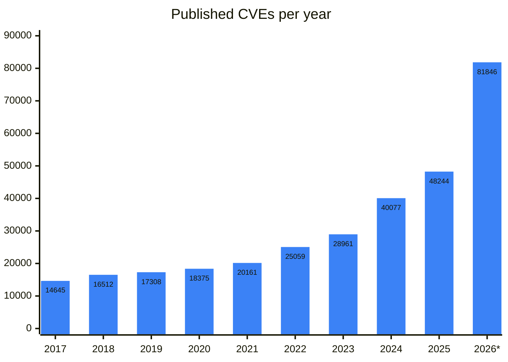
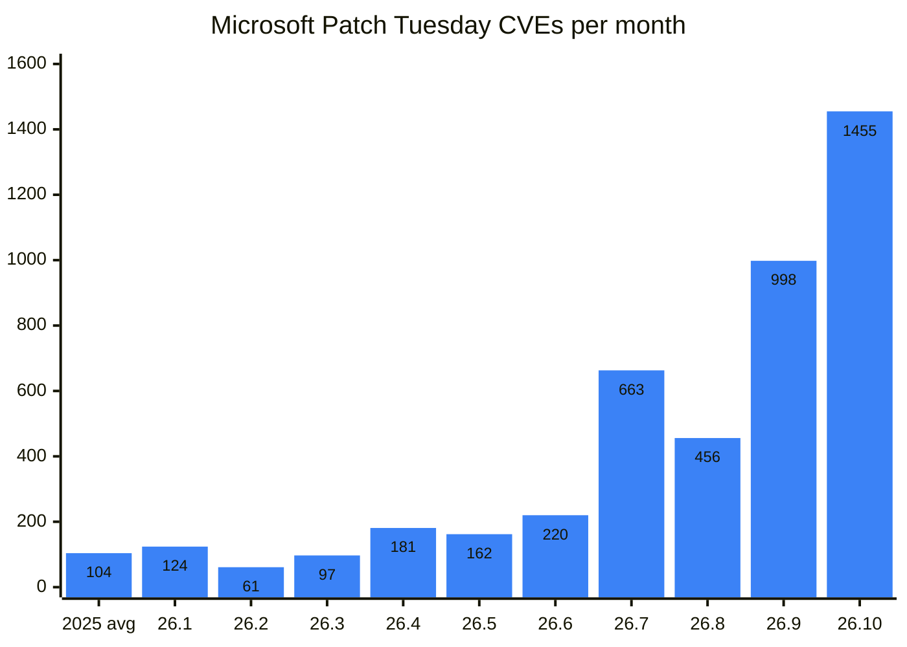

A few days ago, in [Getting Vulnerabilities Found by AI Scanners to Developers](/posts/from-ai-found-bug-to-fix/), I walked through how a bug found by AI gets handed to a maintainer and fixed. Fixing it isn't the end, though. Once a patch is out, it still takes time to land on real servers and devices, and in the meantime attackers read the patch and build an exploit.

I raised a similar question in a short post back in March, [The Accelerating Gap Between Attack and Defense in the Age of AI](/posts/ai-accelerating-attack-defense-gap/). The time from disclosure to a working exploit keeps shrinking, so can patching keep up? And if we can't get rid of every vulnerability, wouldn't it matter more to limit how far the damage spreads when one is there (the blast radius)? At the time, those questions were mostly gut feeling.

In the seven months since, the news about AI-found bugs and exploits has only picked up, and a good amount of data has come out. So I went back and checked those questions against the numbers.

## The flood of vulnerabilities

These days there's news almost every week about someone using AI to find bugs and build the exploit too. In August, Apple shipped an emergency patch for an unauthenticated remote root bug in macOS Screen Sharing, and Calif had an exploit about 4 hours after it started diffing the patch[^calif-screen-sharing].

The number of CVEs keeps climbing too.

_\* 2026 is through October 17. Sources: official CVE.org counts through 2025[^cve-metrics], cve.icu (based on NVD and CVE records) for 2026[^cve-icu]_

With more than two months still left in 2026, the count is already 1.7 times last year's. That doesn't mean there are 1.7 times as many bugs, though. Since the Linux kernel became a CNA that issues its own CVEs, it assigns CVEs broadly to fixes that could be security issues[^kernel-cve-docs], and according to the Google Threat Intelligence Group (GTIG), none of the roughly 5,000 "Linux Kernel" CVEs from January to August this year was exploited as a zero-day[^gtig-ai-era].

Still, more records means a longer list of things to fix. CVEs issued by Microsoft jumped several times over starting in July this year.

_The first bar is the 2025 monthly average. I counted only CVEs issued by Microsoft in the Security Update Guide, as of October 17, 2026[^msrc-update-guide]._

Windows CVEs found and fixed with MDASH, the AI vulnerability discovery system my team at Microsoft built, came to 140 from May through September alone[^ms-frontier-ai-lessons]. The more we find, the more patches customers have to install.

Exploits are up as well. GTIG counted 141 vulnerabilities exploited in the wild from January to August this year, already more than all of last year (127). GTIG thinks the increase came mostly from quickly weaponizing bugs that had already been fixed (n-days), possibly because LLMs have made patch diffing easy. Only about 0.23% of this year's published vulnerabilities were seen exploited[^gtig-ai-era], but that small set gets weaponized fast, and the raw material is the patch.

## Attacks got faster

An attacker only needs to build an exploit from public information and start scanning. A defender has to go from impact analysis through patch development, testing, and deployment, and then wait for users to update. So the shorter the time from patch to exploitation gets, the worse it is for defenders.

That time was shrinking fast even before AI. By Mandiant's count, it averaged 63 days in 2018-19 and just 5 days in 2023[^mandiant-tte-2023].

Take ToolShell in SharePoint. The patch came out on July 8 last year, and ten days later, on July 18, mass exploitation began and more than 400 systems were breached[^eye-sharepoint].

AI is shrinking that time further. On October 7, the Microsoft Edge team used the term patch-gap abuse for attacks that build exploits by reading Chromium fixes, and said AI can cut that analysis from weeks to hours. So Edge can now ship critical security updates before the CVE is published[^edge-patch-gap].

The "weeks" part matches my own experience. At the end of 2022, I spent 5 weeks with teammates who were new to V8, hunting for already-fixed 1-days in the Chromium-based browser on one device. Most of the time went into porting PoCs to the ARM device and turning crashes into exploits, and we ended up with full exploits for only 2 of them. In my current team's experience, that time has gotten much shorter.

Anthropic's June experiment puts numbers on how much faster AI makes this. Given only what an attacker would have on the day a patch ships[^anthropic-n-days], Claude Mythos Preview built code execution exploits from 8 of 18 security patches for Firefox's JavaScript engine, and the first one came in under an hour. From Windows kernel patches, with no source code, it also built 8 exploit chains to SYSTEM, and on the Autopatch schedule the patch would not yet have reached a single device. Anthropic noted that real attacks still take more work, but wrote that "N-hour" is now closer to reality than "N-day".

## Patches still arrive late

The patch gap gets longer the further downstream you go from upstream. OtterSec notes that downstream projects can fall behind on updates, backport fixes incorrectly, or forget them entirely. In April, Samsung Internet, the default browser on the Galaxy S25, was running a V8 that was 6 months old, so a renderer RCE could be built from bugs that were already public[^ottersec-samsung].

Mobile has even more steps. In my March post I wrote that a smartphone patch can take more than 6 months to get through carriers to users, and there's a case where just getting an upstream fix into Android took 6 months, before carriers were even involved. A Mali GPU driver bug (CVE-2022-38181) that ARM fixed in October 2022 didn't make it into an Android security update until April 2023, and in the meantime it was exploited in the wild starting in November 2022[^bleeping-android-patch-gap].

Even after a patch arrives, someone has to install it, and that step has actually gotten slower. According to Verizon's 2026 DBIR, the share of actively exploited vulnerabilities (CISA KEV) that organizations fully fixed dropped from 38% in 2024 to 26% in 2025, and the median time to fix went up from 32 days to 43 days[^verizon-dbir-2026].

Each of these numbers has its limits, but the direction is clear. The small set of vulnerabilities that actually get exploited are weaponized faster than patches get installed.

## First, know whether you're affected

The first defensive step is impact analysis. When a new vulnerability drops, you need to know where in your products that component lives, and during Log4Shell many organizations couldn't answer right away. An SBOM (Software Bill of Materials) is how you write this down ahead of time.

Real SBOMs are emptier than you'd expect. In a study of 78,612 SBOMs, 52.9% didn't list a single dependency relationship between components. The researchers' own prioritization system read those empty relationships as "no path, so unreachable" and missed 7 of 20 actively exploited vulnerabilities because of it, Log4Shell among them[^arxiv-sbom-edges].

What worries me more in the AI era is patches that ship without CVEs. Checking impact with an SBOM eventually means matching it against identifiers like CVEs, and GTIG says large cloud and SaaS companies fix AI-found vulnerabilities directly in production without CVEs[^gtig-ai-era]. For SaaS that's fine: once the provider fixes it, users have nothing to do.

The problem is software you install and run yourself. A STAR Labs researcher used an AI bug-hunting harness to find a post-auth RCE in Cisco Smart Software Manager within an hour, and before it could even be reported, it was quietly fixed in the next day's update[^starlabs-dirty-cert]. The CVE and advisory for a command injection fixed in that same version came out almost two months later, on October 7[^cisco-ssm-adv]. In between, matching your SBOM against CVEs wouldn't show this patch at all. So lowering the cost of always staying up to date matters as much as picking the right patches to install.

## How do we shorten the patch cycle?

How do you lower that cost? In [my last post](/posts/from-ai-found-bug-to-fix/), I asked whether patches should go out carefully after full validation, or fast with AI and fixed again if something breaks. It isn't a choice between the two. The industry is moving toward shipping fast, but in stages and in a way that can be rolled back.

That means treating a patch as a deployment problem before a security problem. Translated into operations terms:

- A vulnerability is a potential outage.
- A patch is a unit of change that needs to be deployed safely.
- A failed validation is a rollback condition.

Here's how the methods in use today fit into that frame.

**Ship security fixes small, and separate from features.** Since 2023, Chrome has released every week, shipping security fixes 3.5 days sooner on average[^chrome-weekly-updates]. Hotpatch for Windows Server 2025 carries only security fixes, applies them without a reboot, and cuts planned reboots from every month to about 4 times a year[^ms-hotpatch].

**Roll out in stages, stop when something looks wrong, and roll back only what broke.** The counterexample is the CrowdStrike incident in July 2024, when a single content update took down about 8.5 million Windows machines[^ms-crowdstrike]. CrowdStrike had pushed that update everywhere at once with no stages, and afterward moved to staged deployment through canaries and rings, with rollback[^crowdstrike-rca]. Windows Autopatch likewise pauses deployment when a ring's stability signals get worse, and Known Issue Rollback reverts only the change that caused the problem, so the security fixes stay in place[^windows-vuln-mgmt].

**Automate validation instead of adding approval steps.** DORA research found that processes like an external change approval board (CAB) hurt delivery performance, and found no evidence that they lower failure rates. Instead, it recommends peer review and automated testing to catch bad changes early[^dora-change-approval].

**Fix the root cause and the variants.** If the first patch is wrong, one fast patch becomes two. ToolShell had a variant that bypassed the July 8 patch, so another emergency patch had to go out[^ms-sharepoint-toolshell]. Project Zero reported that about half of the zero-days seen in the first half of 2022 were variants of bugs that had already been patched[^p0-mind-the-gap].

## What should we fix first?

The basis for setting the order is also moving from the CVSS score to real-world exploitation risk. According to Android Authority, starting in July 2025 Android's monthly security bulletin includes only high-risk vulnerabilities, such as ones that are actively exploited or part of known attack chains, and most fixes are bundled into quarterly releases[^androidauthority-risk-based].

Zero Day Clock calculates every month how much the rule matters. Fixing everything with CVSS 9 or higher means fixing 1,553 a month, yet of the 131 vulnerabilities newly seen attacked in September, only half were on that list beforehand. Fixing only what's on a KEV list or has an EPSS (estimated 30-day exploitation probability) of 3% or higher cuts that to 629 a month, and 79% were already on the list[^zdc-home]. It's a small sample from honeypots and IDS sensors, but the gap is clear.

Still, KEV and EPSS don't know your environment. They only tell you whether a vulnerability has already been exploited or is likely to be soon, and that answer is the same for everyone. Real risk comes from adding whether it's exposed to the internet in your environment, whether attackers can reach it, and how far the damage spreads if it's hit. CVSS, too, splits this up: the base score reflects only the severity of the vulnerability itself, and the impact in a given environment is left for the organizations using the software to score[^cvss-31-spec]. Prioritizing decides what comes first, though; it doesn't mean you can skip the rest.

## Can we hold out until the patch arrives?

Even with good priorities and fast fixes, gaps remain. According to VulnCheck, about 29% of the 884 vulnerabilities first seen exploited in 2025 were exploited on or before the day the CVE was published[^vulncheck-2026]. The ones exploited before a patch existed can't be stopped by patching speed.

So instead of fixing bugs one at a time, the companies leading the way make whole classes of bugs impossible. By writing new code in memory-safe languages like Rust, Android brought the share of memory safety vulnerabilities down from 76% in 2019[^google-memory-safety] to below 20% in 2025[^google-rust-android]. Most vulnerabilities live in new or recently changed code, so writing new code safely brings the total down[^google-memory-safety]. On the web, Google has nearly eliminated XSS and SQL injection in apps built on its main frameworks[^google-secure-by-design].

The speed results are interesting too. Rust changes in Android had 4 times fewer rollbacks than C++ changes (for medium and large changes)[^google-rust-android]. Paying attention to security doesn't always slow you down.

Memory bugs in existing code can also be blocked at the OS and chip level. According to Apple, its offensive research team tried to get real spyware exploit chains that had targeted iPhones working again on devices with its memory protection feature MIE turned on, and couldn't make a single one work[^apple-mie]. It's probably not perfect, but defenses like this don't so much stop attacks as make them much more expensive.

Still, you can't eliminate every bug, so you need to shrink the blast radius, how far the damage spreads once something is breached. If one vulnerability in service A lets an attacker take the whole database, the blast radius is huge, but if service A was designed to reach only its own data, the damage stops there. The tools for this are things like least privilege, service isolation, identity segmentation, and runtime detection.

Without that separation, one bug turns into a full compromise. Identity in particular, once stolen, crosses many boundaries at once. According to CISA, Volt Typhoon got hold of a domain admin account improperly stored on an unpatched Fortinet device, and at a water utility used admin credentials to move through the domain controller and vCenter, potentially reaching connection profiles for water treatment plants and a substation[^cisa-aa24-038a].

That said, shrinking the blast radius doesn't replace patching. In M-Trends 2026, exploits were the most common initial infection vector for the sixth year in a row (32%). Espionage groups target VPNs and routers, which have no EDR and are hard to see into, and the BRICKSTORM backdoor hid on such devices for almost 400 days, so 90-day log retention held no trace of it[^m-trends-2026]. The CISA advisory on Volt Typhoon also lists patching internet-facing systems as the first mitigation[^cisa-aa24-038a].

To sum up, I think we need to do three things at once: eliminate whole classes of bugs through design, contain the bugs that remain, and put the internet-facing devices you can't contain at the front of the patch queue, while always watching identity.

## When the security team becomes a gate

With this many patches coming in, who checks them all? If the security team becomes a gate that reviews every patch and change, it can easily turn into a bottleneck. It's the same human sign-off problem I wrote about in [When I Hand Work to an Agent, Who Makes the Judgment Calls?](/posts/agent-delegation-and-code-review/).

So I see building security in not as teaching developers more security, but as getting developers to keep making safer choices without having to think about security. That's what Google did above, and Google's Secure by Design paper also says the development environment, not each individual developer, should own security[^google-secure-by-design].

As for who builds that environment, Dan McKinley's Egoless Engineering talk stuck with me[^egoless-engineering].

- At one B2B company with more than 1,000 people, the security team was made to do all the security work, and it couldn't keep up. Putting a wall between development and security actually creates more security work.
- At a startup, they gave a designer deploy access, and the engineers used their spare time to build monitoring and tests so those deploys would be safe. Nothing bad happened.

That company tried to have domain experts but not domain owners, and he says this takes permission and slack. It wasn't trust alone that made it safe, but the guardrails built with that slack. I couldn't find research that directly shows a security team acting as a gate slows patching down, though.

A security team that uses AI should likewise be an expert, not an owner. Instead of personally reviewing every patch, it decides what to automate and sets up safe defaults, tests, staged rollouts, and rollback.

## Who patches the software agents use?

Agent systems carry the same patch gap. Browsers, image and audio codecs, document parsers, and countless libraries inside the sandbox each have their own patch gap.

The OpenAI case Hacktron published in September shows how far such a gap can reach[^hacktron-openai]. A bug in the image library libheif had been fixed upstream last year when the code changed, but the commit had neither a security label nor a CVE, and the fix wasn't backported to Debian 12 and 13 in time. Hacktron thinks the missing label may be why. The Discourse Docker image behind the OpenAI community forum is based on Debian 12 and shipped that libheif as is, and with an exploit built using Claude, Hacktron ran code on the forum server just by uploading a HEIC image. Combined with an OpenAI SSO configuration issue, that meant they could take over the ChatGPT and Codex accounts of anyone logged into the forum, and they actually opened a PR on the internal monorepo through the Codex of an OpenAI employee who had GitHub connected. It took less than three days from finding the bug.

What got breached was the forum server, not an agent's sandbox, but one bug quietly fixed upstream rode identity and an agent's GitHub connection all the way to the company's internal repository. Agents add both more doors in (the dependencies inside the sandbox) and more places to go once inside (connectors and permissions).

Model companies and agent systems are still young, so patch management may be lagging behind how fast they add features. How do you know what's inside the sandbox, keep it always up to date, and contain it so a breach doesn't spread, all at the same time?

## When patches can't be installed, or never come

The methods so far all assume the patch eventually arrives and that you can install it when it does. The Anthropic post from earlier closes by saying that as the cost of turning a patch into a weapon approaches zero, places where patching was always hard, like industrial control systems, medical devices, and IoT devices, become more exposed[^anthropic-n-days].

Factories and hospitals struggle to install a patch even when it arrives. From my own experience, in a factory even a short line stoppage can cost tens of billions of won, so equipment software gets validated for a long time and keeps running the old version in the meantime. In 2018 at TSMC, a skipped virus scan during new equipment installation let a WannaCry variant spread to unpatched Windows 7 machines, shutting down several fabs with losses estimated at about $170 million[^bankinfosec-tsmc].

In hospitals, updates become a patient safety issue. In 2017, Abbott released a firmware update for a vulnerability that let someone nearby wirelessly change a pacemaker's settings, and because the update carried a small risk of the device reverting to its previous firmware or stopping, it said doctors should decide with their patients[^abbott-pacemaker].

Hospitals as a whole look similar. When Claroty analyzed more than 2.25 million medical devices across 351 healthcare organizations, 99% of the organizations had devices with actively exploited vulnerabilities (KEV), and it says such devices can't be updated easily because of manufacturer restrictions or concerns about disrupting care[^claroty-healthcare-2025].

In places like these, even staged rollouts can't validate ahead of time what one update will break at every site. The EU Cyber Resilience Act, too, requires automatic security updates to be on by default starting December 2027, but makes an exception for settings like industrial environments, where automatic updates could disrupt operations[^eu-cra-regulation].

Harder still is when the patch never comes, because the vendor is gone or support has ended. A runZero report covering about 8 million assets across hundreds of US companies found that, well beyond factories and hospitals, 5% of all enterprise assets ran an OS past even extended support[^runzero-undead]. Where patches can't be installed or never come, is containing or replacing really all that's left?

## Closing thoughts

In my last post, I wrote that finding a bug doesn't fix anything by itself. This time I found that fixing a bug doesn't protect anyone yet either. The vulnerabilities that actually get exploited are weaponized before the patch is installed, and containment alone can't replace patching. We have to make receiving patches cheap and safe, and once you factor in agents, factories, and hospitals, there's still a long way to go.

## Key takeaways

- With AI, building an exploit from a patch can now take just hours, but patches still take weeks to months to get from upstream to users' devices.
- Many bugs get fixed without CVEs, so making it easy to always stay up to date matters as much as choosing what to fix. Ship security fixes small, separately, and automatically, and set priorities by real risk, not CVSS.
- Patching alone isn't enough. Eliminate whole classes of bugs, contain what's left, and put the exposed surfaces you can't contain first in line for patches, all at the same time.

## References

* References
{:footnotes}

[^calif-screen-sharing]: [Calif, No Country for Old Passwords (2026-08-10)](https://blog.calif.io/p/no-country-for-old-passwords)
[^cve-metrics]: [CVE.org, Metrics](https://www.cve.org/about/Metrics)
[^cve-icu]: [cve.icu](https://cve.icu/)
[^kernel-cve-docs]: [The Linux Kernel Documentation, CVEs](https://docs.kernel.org/process/cve.html)
[^gtig-ai-era]: [Google Threat Intelligence Group, Vulnerability Discovery and Exploitation Trends in the AI Era (2026-09-30)](https://cloud.google.com/blog/topics/threat-intelligence/vulnerability-discovery-and-exploitation-trends-in-the-ai-era)
[^msrc-update-guide]: [Microsoft, Security Update Guide](https://msrc.microsoft.com/update-guide)
[^ms-frontier-ai-lessons]: [Microsoft Security, 3 Lessons from Frontier AI Vulnerability Research (2026-10-07)](https://www.microsoft.com/en-us/security/blog/2026/10/07/3-lessons-from-frontier-ai-vulnerability-research/)
[^mandiant-tte-2023]: [Mandiant, How Low Can You Go? An Analysis of 2023 Time-to-Exploit Trends (2024-10-15)](https://cloud.google.com/blog/topics/threat-intelligence/time-to-exploit-trends-2023)
[^eye-sharepoint]: [Eye Security, SharePoint Under Siege (2025-07-19)](https://labs.eye.security/sharepoint-under-siege/)
[^edge-patch-gap]: [Microsoft Edge, AI and the Rise of Patch-Gap Abuse (2026-10-07)](https://microsoftedge.github.io/edgevr/posts/AI-And-Rise-Patch-Gap-Abuse/)
[^anthropic-n-days]: [Anthropic, Measuring LLMs' Impact on N-day Exploits (2026-06-08)](https://www.anthropic.com/research/n-days)
[^ottersec-samsung]: [OtterSec, Patch Gap to Mobile Renderer RCE: Pwning Samsung Internet's V8 on the Galaxy S25 (2026-04-01)](https://osec.io/blog/patch-gap-to-mobile-renderer-rce/)
[^bleeping-android-patch-gap]: [BleepingComputer, Google: Android Patch Gap Makes N-Days as Dangerous as Zero-Days (2023-07-30)](https://www.bleepingcomputer.com/news/security/google-android-patch-gap-makes-n-days-as-dangerous-as-zero-days/)
[^verizon-dbir-2026]: [Verizon, 2026 Data Breach Investigations Report](https://www.verizon.com/business/resources/T1ae/reports/2026-dbir-data-breach-investigations-report.pdf)
[^arxiv-sbom-edges]: [No Edges, No Verdict (arXiv, 2026-07)](https://arxiv.org/abs/2607.22140)
[^starlabs-dirty-cert]: [STAR Labs, Dirty Cert: Cisco Smart Software Manager's Silently Patched RCE (2026-09-24)](https://starlabs.sg/blog/2026/09-dirty-cert-cisco-smart-software-managers-silently-patched-rce/)
[^cisco-ssm-adv]: [Cisco, Cisco License (Smart Software Manager) On-Prem Vulnerabilities (2026-10-07)](https://sec.cloudapps.cisco.com/security/center/content/CiscoSecurityAdvisory/cisco-sa-ssm-access-nttb2dhE)
[^chrome-weekly-updates]: [Google, An Update on Chrome Security Updates (2023-08-08)](https://security.googleblog.com/2023/08/an-update-on-chrome-security-updates.html)
[^ms-hotpatch]: [Microsoft, Tired of All the Restarts? Get Hotpatching for Windows Server (2025-04-24)](https://www.microsoft.com/en-us/windows-server/blog/2025/04/24/tired-of-all-the-restarts-get-hotpatching-for-windows-server/)
[^ms-crowdstrike]: [Microsoft, Helping Our Customers Through the CrowdStrike Outage (2024-07-20)](https://blogs.microsoft.com/blog/2024/07/20/helping-our-customers-through-the-crowdstrike-outage/)
[^crowdstrike-rca]: [CrowdStrike, Channel File 291 Incident Root Cause Analysis (2024-08-06)](https://www.crowdstrike.com/wp-content/uploads/2024/08/Channel-File-291-Incident-Root-Cause-Analysis-08.06.2024.pdf)
[^windows-vuln-mgmt]: [Windows, Evolving Windows Vulnerability Management to Meet the Speed of AI-Powered Discovery (2026-07-09)](https://blogs.windows.com/windowsexperience/2026/07/09/evolving-windows-vulnerability-management-to-meet-the-speed-of-ai-powered-discovery/)
[^dora-change-approval]: [DORA, Streamlining Change Approval](https://dora.dev/capabilities/streamlining-change-approval/)
[^ms-sharepoint-toolshell]: [Microsoft Security, Disrupting Active Exploitation of On-Premises SharePoint Vulnerabilities (2025-07-22)](https://www.microsoft.com/en-us/security/blog/2025/07/22/disrupting-active-exploitation-of-on-premises-sharepoint-vulnerabilities/)
[^p0-mind-the-gap]: [Project Zero, Mind the Gap (2022-11-22)](https://projectzero.google/2022/11/mind-the-gap.html)
[^androidauthority-risk-based]: [Android Authority, Google Wants to Make Android Phones Safer by Switching to 'Risk-Based' Security Updates (2025-09-13)](https://www.androidauthority.com/android-risk-based-security-updates-3597466/)
[^zdc-home]: [Zero Day Clock](https://zerodayclock.com/)
[^cvss-31-spec]: [FIRST, CVSS v3.1 Specification Document](https://www.first.org/cvss/v3.1/specification-document)
[^vulncheck-2026]: [VulnCheck, State of Exploitation 2026 (2026-01-21)](https://www.vulncheck.com/blog/state-of-exploitation-2026)
[^google-memory-safety]: [Google, Eliminating Memory Safety Vulnerabilities at the Source (2024-09-25)](https://security.googleblog.com/2024/09/eliminating-memory-safety-vulnerabilities-Android.html)
[^google-rust-android]: [Google, Rust in Android: Move Fast and Fix Things (2025-11-13)](https://blog.google/security/rust-in-android-move-fast-fix-things/)
[^google-secure-by-design]: [Christoph Kern, Secure by Design at Google (2024)](https://research.google/pubs/secure-by-design-at-google/)
[^apple-mie]: [Apple, Memory Integrity Enforcement (2025-09-09)](https://security.apple.com/blog/memory-integrity-enforcement/)
[^cisa-aa24-038a]: [CISA, PRC State-Sponsored Actors Compromise and Maintain Persistent Access to U.S. Critical Infrastructure (AA24-038A) (2024-02-07)](https://www.cisa.gov/news-events/cybersecurity-advisories/aa24-038a)
[^m-trends-2026]: [Mandiant, M-Trends 2026 (2026-03-23)](https://cloud.google.com/blog/topics/threat-intelligence/m-trends-2026)
[^egoless-engineering]: [Dan McKinley, Egoless Engineering](https://egoless.engineering/)
[^hacktron-openai]: [Hacktron, Hacking OpenAI (2026-09-13)](https://www.hacktron.ai/blog/hacking-openai)
[^bankinfosec-tsmc]: [BankInfoSecurity, WannaCry Outbreak Hits Chipmaker, Could Cost $170 Million (2018-08-07)](https://www.bankinfosecurity.com/chipmaker-tsmc-wannacry-attack-could-cost-us170-million-a-11285)
[^abbott-pacemaker]: [Abbott, Important Cybersecurity Advisory: Pacemaker Firmware Update (2017-08-28)](https://www.cardiovascular.abbott/content/dam/cv/cardiovascular/pdf/reports/Pacemaker-Firmware-Update-Doctor-Letter-Aug2017-US.pdf)
[^claroty-healthcare-2025]: [Claroty, State of CPS Security: Healthcare Exposures 2025 (2025-03-26)](https://www.claroty.com/blog/clarotys-state-of-cps-security-report-healthcare-exposures-2025)
[^eu-cra-regulation]: [Regulation (EU) 2024/2847, Cyber Resilience Act](https://eur-lex.europa.eu/legal-content/EN/TXT/HTML/?uri=CELEX:32024R2847)
[^runzero-undead]: [runZero, Undead by Design (2025-10-01)](https://www.runzero.com/resources/undead-by-design-report/)
